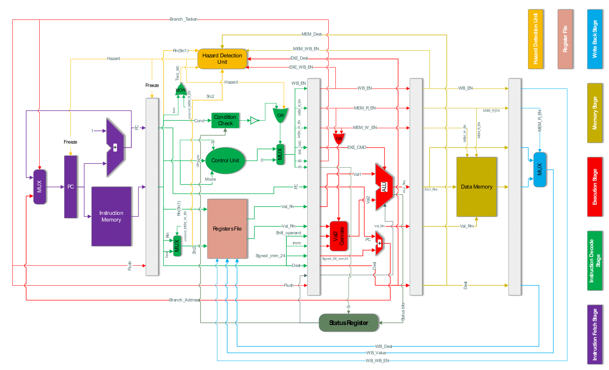

# 5-Stage Pipelined ARM Processor

A 5-stage pipelined 32-bit ARM processor core written in Verilog HDL. Developed for the Computer Architecture Lab at the University of Tehran, the design implements an ARMv7 instruction subset with hardware hazard detection and full data forwarding.

## Quickstart

Run the automated simulation script in ModelSim:

```bash
vsim -do sim/run.do
```

Alternatively, from the ModelSim interactive console:

```tcl
do sim/run.do
```

The script compiles the RTL modules in dependency order, loads `Top_tb`, binds signal groups into the Wave window, runs the simulation, and prints the final register states (`R0`-`R6`) to the console.

To clean generated simulation artifacts (`work/`, `transcript`, `*.wlf`, etc.):

```bat
scripts\clean.bat
```

## Architecture

The processor follows the classic 5-stage RISC pipeline:

```
[ IF ] ---> (IF/ID Reg) ---> [ ID ] ---> (ID/EXE Reg) ---> [ EXE ] ---> (EXE/MEM Reg) ---> [ MEM ] ---> (MEM/WB Reg) ---> [ WB ]
  |                            |                             |                               |                            |
  +-------- Branch ------------+---- Stall / Flush ----------+------- Data Forwarding -------+----------------------------+
```



### Pipeline Stages

* **Instruction Fetch (IF):** Tracks the program counter via `PC_reg`, increments it sequentially using `PC_adder`, resolves branch targets via `PC_mux`, and fetches 32-bit instructions from `instruction_mem`.
* **Instruction Decode (ID):** Decodes opcodes using `control_unit`, reads operands from the 16-register `RegisterFile`, evaluates branch condition flags against the status register via `condition_check`, and unpacks immediate and shift fields.
* **Execute (EXE):** Executes ALU arithmetic and logic operations, computes branch target addresses, generates shifted second operands via `Val2Generator` and `shift_operand`, and updates condition flags in `StatusRegister`.
* **Memory Access (MEM):** Handles single-cycle data reads and writes through `data_mem` for load/store instructions.
* **Write-Back (WB):** Routes either ALU results or memory load data back into the destination register in `RegisterFile`.

### Hazard Management

* **Forwarding Unit (`Forwarding_Unit.v`):** Resolves RAW (Read-After-Write) data hazards by feeding results from the `MEM` and `WB` stages directly into the `EXE` stage operands (`MEM -> EXE` and `WB -> EXE`), eliminating stalls for ALU-to-ALU dependencies.
* **Hazard Detection Unit (`Hazard_Detection_Unit.v`):** Identifies Load-Use hazards where a dependent instruction immediately follows `LDR`. It freezes the `PC` and `IF/ID` registers and inserts a single-cycle bubble into `ID/EXE`. It also coordinates with branch resolution to flush invalid instructions in `IF` and `ID` when a branch is taken.

## Supported Instructions

* **Data Processing:** `ADD`, `ADC`, `SUB`, `SBC`, `AND`, `ORR`, `EOR`, `MOV`, `MVN`
* **Comparisons & Tests:** `CMP`, `TST` (updates `NZCV` flags in the status register)
* **Memory Access:** `LDR`, `STR` (immediate and register offset addressing)
* **Control Flow:** `B` with condition codes (`EQ`, `NE`, `CS/HS`, `CC/LO`, `MI`, `PL`, `VS`, `VC`, `HI`, `LS`, `GE`, `LT`, `GT`, `LE`, `AL`)
* **Shifter Modes:** `LSL`, `LSR`, `ASR`, `ROR` on operand 2

## Limitations & Gotchas

* **Word-Addressed PC:** The program counter increments by 1 word (`PC + 1`) per instruction rather than standard ARM byte addressing (`PC + 4`). Memory indexing reflects word addresses directly.
* **Branch Penalty:** Branch target resolution and condition verification happen in the `EXE` stage. A taken branch incurs a 2-cycle penalty (flushes the `IF` and `ID` pipeline stages).
* **Load-Use Penalty:** Hardware forwarding cannot eliminate the stall when an instruction immediately depends on the result of an `LDR`. A 1-cycle stall bubble is inserted.
* **Simplified Memory System:** Instruction and data memories are implemented as internal behavioral register arrays without cache hierarchy, bus protocols (AHB/AXI), or wait-states.
* **Subsetting:** Floating-point, Thumb/Thumb-2 modes, hardware multiply/divide (`MUL`/`DIV`), and exception/interrupt handling are not implemented.

## Repository Layout

```
ComputerArchitecture-Lab/
|-- docs/                      # Reference manuals, design session slides, diagrams
|   |-- Final_Report.pdf       # Comprehensive final project report
|-- scripts/                   # Utility maintenance scripts
|   `-- clean.bat              # Cleans ModelSim build artifacts and logs
|-- sim/                       # Simulation automation
|   |-- run.do                 # One-click compile and run script for ModelSim
|   `-- wave.do                # Formatted waveform definitions
|-- src/                       # Synthesizable processor RTL
|   |-- Top.v                  # Top-level datapath and control interconnect
|   |-- ALU.v                  # Arithmetic logic unit
|   |-- control_unit.v         # Main control decoder
|   |-- Forwarding_Unit.v      # Operand forwarding logic
|   |-- Hazard_Detection_Unit.v# Pipeline stall and flush controller
|   |-- IF_stage.v             # Instruction fetch stage
|   |-- ID_stage.v             # Instruction decode stage
|   |-- EXE_stage.v            # Execution stage
|   |-- MEM_stage.v            # Memory stage
|   |-- WB_stage.v             # Writeback stage
|   `-- ...                    # Pipeline registers and helper modules
|-- tb/                        # Testbench and verification
|   |-- Top_tb.v               # Top-level testbench
|   `-- instruction_mem.mem    # Machine-code test program
|-- .gitignore                 # Simulator, EDA, and OS ignore patterns
`-- README.md                  # Project documentation
```

## Contributors

* Sepanta Ghonoodi ([@sepanta-ghonoodi](https://github.com/sepanta-ghonoodi))
* Sajad Hasanpour ([@sajadhp](https://github.com/sajadhp))
